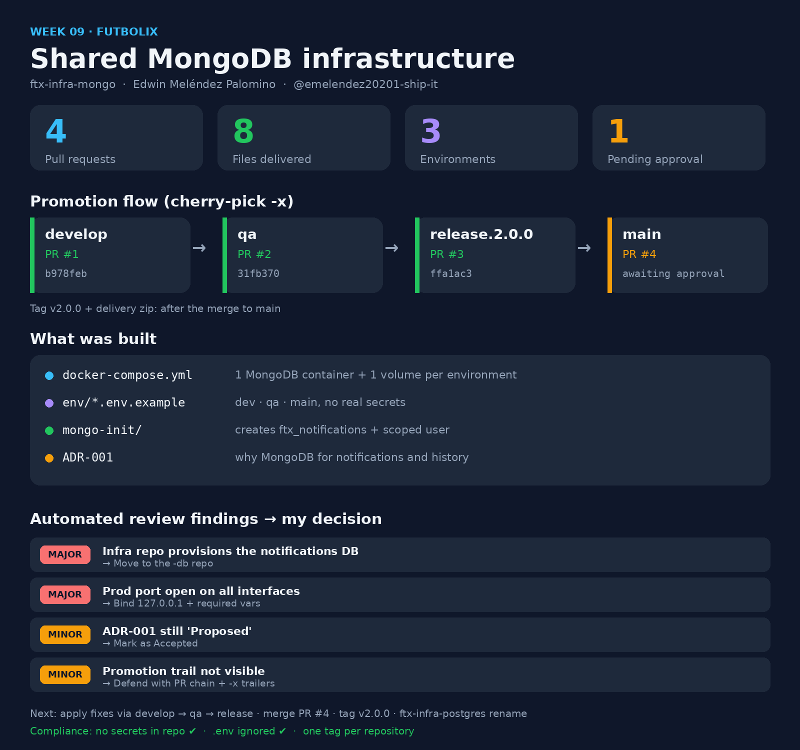

<!-- HU-STATUS TEMPLATE - do NOT remove the <!-- ... --> markers or the table headers.
     Your weekly grade is read AUTOMATICALLY from this file:
       09-week/hu-status/README.md  (inside YOUR fork). English. -->

# Weekly Status - Week 09

<!-- CONFIG-START - must match your profile repo (username/username) CONFIG -->
- FULL_NAME: Edwin Melendez Palomino
- GITHUB_USER: emelendez20201-ship-it
- TEAM: Futbolix
- SPRINT_GOAL: Stand up the shared MongoDB infrastructure (ftx-infra-mongo) for the notifications and reservation-history domain, and promote it through develop, qa and release.2.0.0 towards main following the cherry-pick -x flow.
<!-- CONFIG-END -->

## 1. User stories worked this week

| HU ID | Title | Status (todo/doing/done) | Evidence (PR or commit URL) |
|---|---|---|---|
| HU-NOT-001 | Receive Reservation Confirmation (MongoDB infrastructure for notifications and history) | doing | https://github.com/code-corhuila/ftx-infra-mongo/pull/4 |

## 2. My individual contribution

- Built the `ftx-infra-mongo` repository content: `docker-compose.yml` with a single MongoDB container and one named volume per environment.
- Added one environment file per environment (`env/dev.env.example`, `env/qa.env.example`, `env/main.env.example`) and a `.gitignore` that keeps real `.env` files out of the repository.
- Wrote `mongo-init/01-init-databases.js` to create the `ftx_notifications` logical database and a scoped application user on first boot.
- Wrote ADR-001 justifying MongoDB for the notifications and event-history domain (variable document shape, read as a block, append-only writes).
- Promoted the change by re-application with `git cherry-pick -x`: develop (PR #1, `b978feb`) -> qa (PR #2, `31fb370`) -> release.2.0.0 (PR #3, `ffa1ac3`) -> main (PR #4).
- Reviewed the automated review findings on PR #4 and prepared a decision (apply or justify) for each one.

## 3. Blockers and risks

- PR #4 (release.2.0.0 -> main) is waiting for the teacher's approval; the `v2.0.0` tag and the delivery zip depend on it.
- Release branch name is unconfirmed: `release.2.0.0` (assignment text) vs `release/...` (repository README).
- Review finding (major): the infra repo provisions the notifications database and user; this belongs in the `-db` repository of that domain.
- Review finding (major): the `main` MongoDB port is published on all host interfaces and the passwords are enforced only by documentation.
- Review finding (minor): ADR-001 is still marked "Proposed" although the decision is already implemented.
- Review finding (minor): the promotion trail is only verifiable from the PR chain and the `cherry picked from` trailers.

## 4. Plan for next week

- Decide and document the answer to each review finding; apply the port binding to `127.0.0.1` and required variables in `docker-compose.yml`, and move ADR-001 to "Accepted".
- Move the notifications database provisioning to the domain `-db` repository.
- Merge PR #4 once approved, create the `v2.0.0` tag on `main` and deliver the zip `ftx-infra-mongo-v2.0.0.zip`.
- Update the remote and the README name in `ftx-infra-postgres` (renamed from `ftx-infra`).

## 5. Compliance self-check

- [ ] Conventional Commits - `type(scope): summary`
- [ ] Per-environment HU branch + PR to that environment (hu-xxx-dev -> develop, ...)
- [x] Testable acceptance criteria
- [ ] Tests added/updated (unit / integration)
- [ ] DDD / hexagonal boundaries respected (domain has no I/O)
- [x] No secrets; config via environment variables

## 6. Evidence links

- PR #1 (develop): https://github.com/code-corhuila/ftx-infra-mongo/pull/1
- PR #2 (qa): https://github.com/code-corhuila/ftx-infra-mongo/pull/2
- PR #3 (release.2.0.0): https://github.com/code-corhuila/ftx-infra-mongo/pull/3
- PR #4 (main): https://github.com/code-corhuila/ftx-infra-mongo/pull/4
- ADR-001: https://github.com/code-corhuila/ftx-infra-mongo/blob/develop/docs/adr/ADR-001-mongodb-para-notificaciones.md

