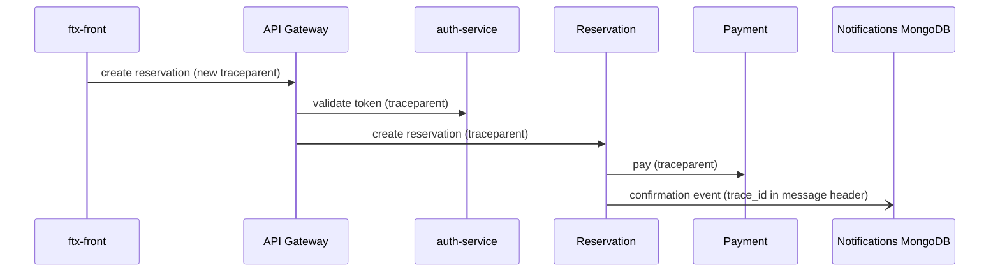

# CP1 - Critical journey and trace map

Journey: Reserve a field, pay and receive the confirmation (HU-RES-002, HU-PAY-001, HU-NOT-001).

| # | Hop | From | To | Endpoint or channel | Trace context |
|---|---|---|---|---|---|
| 1 | Create reservation | ftx-front | API Gateway | FILL_ENDPOINT | creates traceparent |
| 2 | Validate token | API Gateway | auth-service | FILL_ENDPOINT | traceparent header |
| 3 | Check and hold schedule | API Gateway | Reservation (ftx-schedules-db, court_schedule) | FILL_ENDPOINT | traceparent header |
| 4 | Pay reservation | Reservation | Payment (HU-PAY-001) | FILL_ENDPOINT | traceparent header |
| 5 | Confirmation event | Reservation | Notifications (ftx-infra-mongo) | event on the broker | trace_id in message header |

## Span tree

- gateway.create_reservation (root)
  - auth.validate_token
  - reservation.create
    - schedules.check_availability
    - payment.charge
    - notifications.publish_confirmation (async, same trace_id)
