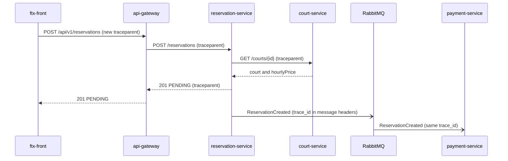

# CP1 - Critical journey and trace map

Journey: a customer creates a reservation and its payment is recorded (HU-RES-002 and HU-PAY-002).
Source: 05-architecture, 07-api/contracts/openapi and 02-domain/domain-events.md of ftx-docs.
Customers do not log in: the public endpoints use `security: []`, so auth-service is not part of this journey.

## Hops

| # | Hop | From | To | Endpoint or channel | Trace context |
|---|---|---|---|---|---|
| 1 | Create reservation | ftx-front | api-gateway (:8080) | POST /api/v1/reservations with Idempotency-Key | ftx-front creates the traceparent (not implemented yet: httpTransport in src/api/client.ts only sets Accept and Content-Type) |
| 2 | Forward request | api-gateway | reservation-service (:8083) | POST /reservations | traceparent header |
| 3 | Read court price and schedule | reservation-service | court-service (:8082) | GET /courts/{id} | traceparent header |
| 4 | Publish ReservationCreated | reservation-service | RabbitMQ futbolix.events | routing key reservation.created, sent after the commit (outbox, ADR-006) | trace_id in the message header |
| 5 | Record the PENDING payment | RabbitMQ | payment-service (:8084) | consumes ReservationCreated, at-least-once | same trace_id read from the message header |

## Sequence diagram

## Span tree

- gateway.create_reservation (root span, trace_id created by ftx-front)
  - reservation.create
    - court.get_court
    - reservation.insert_with_outbox
  - reservation.publish_created (crosses the asynchronous border, same trace_id)
    - payment.consume_reservation_created
      - payment.insert_pending_payment

## Where the trace can break

ftx-front already sends an Idempotency-Key and reuses it when the customer repeats the same intention (src/api/reservations.ts). The same place is the right one to add the traceparent header.

The hop 3 depends on court-service. If it does not answer, reservation-service returns 503 and no event is published.
