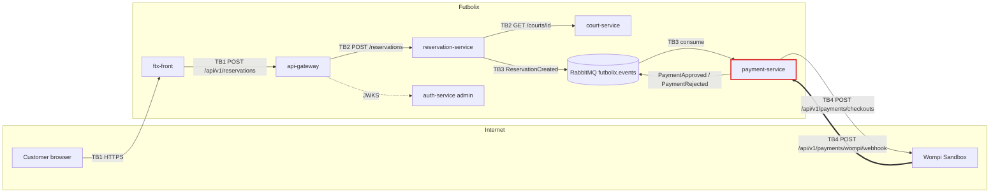

# Attack surface - payment-service <- Wompi webhook

My trust boundary: TB4, between Wompi (external, untrusted) and payment-service (internal).
Claim issue: https://github.com/code-corhuila/ftx-docs/issues/47

## Data flow diagram

TB1 internet to gateway, TB2 gateway to services, TB3 services and broker, TB4 Wompi to payment-service (mine).

## Asset inventory

| Asset | Where it lives | Classification |
|---|---|---|
| Reservation data (customer name, email, phone) | reservation-service | confidential |
| Payment record and status (PENDING, approved, rejected) | payment-service | restricted |
| Wompi checksum and integrity secret | payment-service configuration | restricted |
| Reservation slot (court, date, hour) | reservation-service and court schedule | internal |
| Admin credentials and JWT | auth-service | restricted |
| Domain events (ReservationCreated, PaymentApproved, PaymentRejected) | RabbitMQ futbolix.events | internal |

## Entry points of my boundary

| Entry point | Called by | Authentication today |
|---|---|---|
| POST /api/v1/payments/wompi/webhook | Wompi | Signature in header X-Event-Checksum, verified with the webhook secret (00-governance/security-policy.md) |
| POST /api/v1/payments/checkouts | ftx-front through api-gateway | internal bearer token between services (security-policy.md, internal communication) |
| Consumer of ReservationCreated | RabbitMQ | RabbitMQ user and password (RABBITMQ_USER / RABBITMQ_PASSWORD, 10-devops/environments.md); no mTLS (AT-003 in overview.md) |
